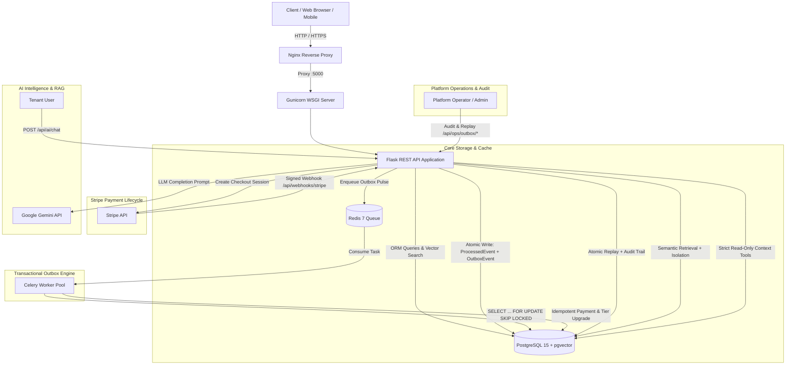

# AbyFlow API

[](tests/)
[](https://www.python.org/)
[](https://flask.palletsprojects.com/)
[](https://www.postgresql.org/)
[](https://docs.celeryq.dev/)
[](https://www.docker.com/)

**AbyFlow** is a multi-tenant SaaS billing, workspace management, and AI intelligence backend built with Flask, SQLAlchemy, Celery, Redis, PostgreSQL, Stripe, and Google Gemini.

It features a high-throughput **Transactional Outbox** pattern with deterministic row locking (`SKIP LOCKED`), fencing tokens, and exponential backoff; strict database-level **Multi-Tenant Isolation**; exact **Deterministic Financial Calculations** using integer cents and `Decimal`; and a **Tenant-Aware Retrieval-Augmented Generation (RAG) AI Assistant** with read-only database tool calling.

> **Note on Payment Model:** AbyFlow currently implements **one-time payments** (`mode='payment'`) via Stripe Checkout for lifetime/fixed-tier access upgrades ($20.00 USD / 2000 cents). It is structurally architected to support recurring subscriptions in future versions.

---

## Project Summary

**AbyFlow — AI-Powered Billing Intelligence Platform**

A multi-tenant SaaS billing platform combining backend engineering with a Gemini-powered billing assistant and retrieval-augmented generation (RAG). The AI assistant uses structured, read-only tools to retrieve workspace billing data and tenant-scoped knowledge, while the backend handles authentication, authorization, invoicing, Stripe billing, asynchronous processing, and auditability.

**AI engineering:** Google Gemini API integration, function/tool calling, conversation persistence, token-usage tracking, embeddings, document chunking, pgvector retrieval, and tenant-aware RAG.

**Backend engineering:** Flask REST APIs, PostgreSQL, SQLAlchemy, multi-tenancy, JWT authentication, Stripe webhooks, idempotency, transactional outbox, Celery, Redis, Docker, and AWS EC2 deployment.

## High-Level Architecture



---

## Core System Capabilities

### 1. Multi-Tenancy & Workspace Governance

- **Personal Workspace Provisioning:** Atomic creation of personal tenant workspaces upon user registration.
- **Role Hierarchy:**
  - **Platform Roles:** `user`, `operator`, `admin` (stored on user record, provisioned via secure host CLI).
  - **Workspace Roles:** `owner`, `admin`, `member` (stored on tenant memberships).
- **Tenant Isolation:** Explicit workspace boundaries enforced across queries, invoices, customer entities, and vector retrieval.

### 2. Transactional Outbox & Reliable Stripe Billing

- **Cryptographic Signature Verification:** Webhooks verified against raw byte payload with replay attack rejection.
- **Atomic Event Ingestion:** Webhook requests atomically persist `ProcessedEvent`, `BillingEvent`, and `OutboxEvent` before returning HTTP 200.
- **Worker Concurrency & Fencing:** Workers claim outbox events using `SELECT ... FOR UPDATE SKIP LOCKED`, assigning a cryptographically secure UUID lease token. Stale workers are prevented from updating the database.
- **Backoff & Dead-Letter Handling:** Exponential backoff scheduling (`10s`, `20s`, `40s`...) up to 5 attempts before marking as `failed`.
- **Payment Idempotency:** Duplicate checkout events and payment intents are safely deduplicated.

### 3. Operations API & Replay Audit

- Dedicated platform endpoints (`/api/ops/outbox/*`) restricted to users with `operator` or `admin` platform roles.
- Operator replay resets retry state atomically, records operator identity, mandatory audit rationale, and previous attempt history.
- Zero public self-promotion routes. First operator provisioned via `scripts/promote_operator.py`.

### 4. Deterministic Billing & Invoicing

- **Customer Management:** Full CRUD scoped strictly to active tenant.
- **Invoice Sequencing:** Atomic per-tenant sequence numbers formatted as `INV-000001` using row-level locking.
- **Financial Exactness:** All line items, taxes, and totals calculated using integer cents and exact `Decimal` precision. No floating-point inaccuracies.
- **Immutable Issued State:** Issued invoices cannot be edited or deleted.

### 5. AI Engineering & Tenant-Aware RAG Engine

- **Gemini Integration:** Google Gemini API for AI chat completion and function/tool calling.
- **Tenant-Aware Retrieval:** RAG retrieval applies workspace-aware filtering so tenant queries are scoped to the active workspace.
- **Gemini Embeddings:** Uses `gemini-embedding-001` with 1536-dimensional vectors for document ingestion and retrieval.
- **Dual-Dialect Vector Storage:** `EmbeddingVector` custom SQLAlchemy type seamlessly uses PostgreSQL `pgvector` in production and `JSON` in SQLite test environments.
- **Deterministic Read-Only Billing Tools:** LLM tool calls execute against audited repository query boundaries; LLMs are strictly forbidden from performing financial computations or mutative actions.
- **Token Usage Auditing:** Prompt, completion, and total token usage are persisted per interaction, alongside an estimated USD cost.
- **Billing Configuration:** Supports free and paid Gemini billing tiers through `GEMINI_BILLING_TIER`. Historical OpenAI pricing records are retained for existing usage data.

---

## Project Structure

```text
AbyFlow/
├── .dockerignore
├── .env.example                     # Environment configuration template
├── .gitignore
├── Dockerfile                       # Hardened, non-root Python 3.12 container
├── docker-compose.yml               # Local development stack
├── docker-compose.prod.yml          # Production stack
├── requirements.txt                 # Runtime dependencies
├── requirements-dev.txt             # Test coverage tooling
├── wsgi.py                          # Production WSGI application entry point
├── app/
│   ├── __init__.py                  # Application factory with /health check
│   ├── config.py                    # Environment configuration classes
│   ├── extensions.py                # Initialized SQLAlchemy, Bcrypt, JWT extensions
│   ├── extentions.py                # Backward-compatibility alias
│   ├── models.py                    # Domain, billing, outbox, and AI models
│   ├── tasks.py                     # Celery outbox poller and processor tasks
│   ├── repositories/
│   │   └── billing_repository.py    # Read-only tenant-scoped billing queries
│   ├── routes/
│   │   ├── ai.py                    # AI chat, conversations, and usage
│   │   ├── auth.py                  # Authentication routes
│   │   ├── customers.py             # Customer CRUD
│   │   ├── invoices.py              # Invoice CRUD and issue
│   │   ├── operations.py            # Outbox inspection and replay
│   │   ├── subscriptions.py         # Checkout, success, and cancel
│   │   ├── tenants.py               # Workspace and membership management
│   │   └── webhooks.py              # Stripe webhook receiver
│   ├── schemas/
│   │   └── stripe_schema.py         # Webhook payload schemas
│   └── services/
│       ├── ai/                      # Gemini assistant, tools, prompts, usage
│       ├── outbox_operations.py     # Outbox inspection and replay logic
│       ├── platform_authorization.py
│       ├── rag/                     # Chunking, embeddings, retrieval, ingestion
│       │   └── reembedding.py       # Existing-vector migration utility
│       ├── stripe_service.py        # Stripe checkout session generator
│       ├── tenant_service.py        # Workspace and membership operations
│       └── user_service.py          # Plan tier upgrades
├── docs/
│   └── knowledge_base/              # Seed documentation
├── migrations/                      # Alembic schema migrations
├── scripts/
│   ├── init_db.py                   # Database initialization
│   └── promote_operator.py          # Secure platform role provisioning
└── tests/
    ├── conftest.py                  # Isolated SQLite testing fixtures
    ├── postgres/                    # PostgreSQL integration tests
    ├── test_ai_layer.py             # AI, RAG, tools, and usage tests
    ├── test_auth.py                 # Auth and tenant isolation tests
    ├── test_customers.py            # Customer domain tests
    ├── test_invoices.py             # Invoice calculations and sequence tests
    ├── test_operations_api.py       # Operations and replay audit tests
    ├── test_outbox.py               # Outbox leasing and idempotency tests
    ├── test_stripe.py               # Stripe checkout and webhook tests
    └── test_tenant_management.py    # Workspace membership tests
```

---

## API Endpoints Reference

### 1. System

| Method | Endpoint | Description | Auth Required |
|---|---|---|---|
| `GET` | `/` | API status and version metadata | No |
| `GET` | `/health` | Live health probe checking DB and Redis | No |

### 2. Authentication

| Method | Endpoint | Description | Auth Required |
|---|---|---|---|
| `POST` | `/api/auth/register` | Register new user and create personal workspace | No |
| `POST` | `/api/auth/login` | Authenticate and obtain JWT access token | No |
| `GET` | `/api/auth/dashboard` | Access user profile and plan tier | Bearer JWT |

### 3. Workspaces & Multi-Tenancy

| Method | Endpoint | Description | Auth Required |
|---|---|---|---|
| `GET` | `/api/tenants` | List accessible workspaces | Bearer JWT |
| `POST` | `/api/tenants` | Create tenant workspace | Bearer JWT |
| `GET` | `/api/tenants/current` | Get current workspace details and role | Bearer JWT + `X-Tenant-ID` |
| `GET` | `/api/tenants/current/members` | List workspace members | Bearer JWT + `X-Tenant-ID` |
| `POST` | `/api/tenants/current/members` | Invite workspace member | Bearer JWT + `X-Tenant-ID` |
| `PATCH` | `/api/tenants/current/members/<id>` | Update member role | Bearer JWT + `X-Tenant-ID` |
| `DELETE` | `/api/tenants/current/members/<id>` | Remove workspace member | Bearer JWT + `X-Tenant-ID` |

### 4. Customers & Invoicing

| Method | Endpoint | Description | Auth Required |
|---|---|---|---|
| `GET` | `/api/customers` | List workspace customers | Bearer JWT + `X-Tenant-ID` |
| `POST` | `/api/customers` | Create customer | Bearer JWT + `X-Tenant-ID` |
| `GET` | `/api/customers/<id>` | Get customer details | Bearer JWT + `X-Tenant-ID` |
| `PATCH` | `/api/customers/<id>` | Update customer | Bearer JWT + `X-Tenant-ID` |
| `DELETE` | `/api/customers/<id>` | Delete customer | Bearer JWT + `X-Tenant-ID` |
| `GET` | `/api/invoices` | List workspace invoices | Bearer JWT + `X-Tenant-ID` |
| `POST` | `/api/invoices` | Create draft invoice | Bearer JWT + `X-Tenant-ID` |
| `GET` | `/api/invoices/<id>` | Get invoice details | Bearer JWT + `X-Tenant-ID` |
| `PATCH` | `/api/invoices/<id>` | Update invoice | Bearer JWT + `X-Tenant-ID` |
| `DELETE` | `/api/invoices/<id>` | Delete invoice | Bearer JWT + `X-Tenant-ID` |
| `POST` | `/api/invoices/<id>/issue` | Issue draft invoice | Bearer JWT + `X-Tenant-ID` |

### 5. Payments & Webhooks

| Method | Endpoint | Description | Auth Required |
|---|---|---|---|
| `POST` | `/api/subscriptions/create-checkout` | Generate Stripe Checkout URL | Bearer JWT |
| `GET` | `/api/subscriptions/success` | Checkout success callback | No |
| `GET` | `/api/subscriptions/cancel` | Checkout cancellation callback | No |
| `POST` | `/api/webhooks/stripe` | Process signed Stripe webhook | `Stripe-Signature` header |

### 6. Platform Operations

| Method | Endpoint | Description | Auth Required |
|---|---|---|---|
| `GET` | `/api/ops/outbox/failed` | List failed outbox events | Platform Operator/Admin JWT |
| `GET` | `/api/ops/outbox/<id>` | Inspect failed outbox event | Platform Operator/Admin JWT |
| `POST` | `/api/ops/outbox/<id>/replay` | Replay failed event and record audit | Platform Operator/Admin JWT |
| `GET` | `/api/ops/outbox/replay-audit` | List replay audit history | Platform Operator/Admin JWT |

### 7. AI Assistant & Tenant-Aware RAG

| Method | Endpoint | Description | Auth Required |
|---|---|---|---|
| `POST` | `/api/ai/chat` | Chat with AI using RAG and read-only tools | Bearer JWT + `X-Tenant-ID` |
| `GET` | `/api/ai/conversations` | List workspace conversations | Bearer JWT + `X-Tenant-ID` |
| `GET` | `/api/ai/conversations/<id>` | Fetch conversation history | Bearer JWT + `X-Tenant-ID` |
| `GET` | `/api/ai/usage` | Inspect token usage and estimated costs | Bearer JWT + `X-Tenant-ID` |
| `POST` | `/api/ai/knowledge/seed` | Seed platform knowledge documentation | Platform Operator/Admin JWT |

---

## Quickstart & Local Development

### 1. Configure Environment

```bash
cp .env.example .env
```

Configure the required environment variables in `.env`:

```env
FLASK_ENV=development
GEMINI_API_KEY=your_gemini_api_key
AI_MODEL=gemini-2.5-flash
AI_EMBEDDING_MODEL=gemini-embedding-001
GEMINI_BILLING_TIER=free
AI_ALLOW_MOCK_EMBEDDINGS=true

DATABASE_URL=postgresql://abyflow_user:abyflow_password@db:5432/abyflow_db
REDIS_URL=redis://redis:6379/0
JWT_SECRET_KEY=dev_jwt_secret_key_change_me
STRIPE_SECRET_KEY=sk_test_your_key
STRIPE_WEBHOOK_SECRET=whsec_your_key
```

Use real credentials only in your local `.env` file. Never commit `.env` or expose API keys.

### 2. Install Dependencies

```bash
python -m pip install -r requirements.txt
```

### 3. Start Application Stack

```bash
docker compose up -d --build
```

### 4. Apply Database Migrations

Apply the tracked Alembic migrations before using the API:

```bash
docker compose exec web flask db upgrade
```

The same operation can be run with `python scripts/init_db.py` from a host environment configured to reach the target database. Do not use `db.create_all()` as a substitute for the migration history.

The development stack includes:

- PostgreSQL 15 with pgvector extension support.
- Redis 7 broker.
- Flask REST API served through Gunicorn.
- Celery background outbox processor.

### 5. Provisioning a Platform Operator

Workspace owners cannot manage platform infrastructure. Provision an operator using the secure host CLI:

```bash
python scripts/promote_operator.py admin@example.com --role operator
```

---

## Automated Test Suites

AbyFlow includes automated tests for application behavior, database operations, AI integration, and tenant isolation.

- **Unit & Integration Suite:** SQLite-based tests with mocked external APIs.
- **PostgreSQL Integration Suite:** PostgreSQL row-locking, concurrency, pgvector retrieval, and tenant-isolation validation against a PostgreSQL test database.

### Install development tools

```bash
pip install -r requirements-dev.txt
```

### Run the complete suite

Set `ABYFLOW_TEST_DATABASE_URL` to a dedicated PostgreSQL test database named `abyflow_concurrency_test`, then run:

```bash
pytest -v
```

### Run the suite without PostgreSQL integration tests

```bash
pytest -v --ignore=tests/postgres
```

### Current local validation

The Gemini migration has passed the following reported checks:

- Python compilation: passed.
- `pytest --ignore=tests/postgres`: **273 passed**.
- `pytest tests/test_ai_layer.py`: **47 passed**.
- Gemini text-generation test: passed.
- Gemini embedding test: passed with 1536 dimensions.
- Gemini function-calling test: passed.

The PostgreSQL integration tests were excluded from the 273-test run because they require a separately configured `ABYFLOW_TEST_DATABASE_URL`. They have not been counted as passing.

### Generate coverage

```bash
pytest --cov=app --cov-report=term-missing --cov-report=html
```

Open `htmlcov/index.html` to inspect uncovered lines.

---

## Production Deployment (AWS EC2)

AbyFlow uses Docker Compose for application services and Nginx as a host-level reverse proxy.

The existing deployment uses an AWS EC2 instance with Amazon Linux 2023. Deployment instructions must be adapted to the current server configuration rather than assuming a new instance.

Before updating a production deployment:

1. Confirm the local code and tests are ready.
2. Commit and push the validated changes to GitHub.
3. Create a fresh PostgreSQL backup and verify that it can be read.
4. Confirm production environment variables, including `GEMINI_API_KEY`.
5. Review the existing Docker Compose services and volumes before rebuilding.
6. Update only the intended AbyFlow application services.
7. Apply database migrations only when required and after reviewing migration status.
8. Verify application health and the AI endpoints after deployment.

Do not remove database volumes or recreate PostgreSQL and Redis unnecessarily. Do not modify unrelated applications hosted on the same EC2 instance.

### Gemini RAG migration warning

Existing OpenAI embeddings are not compatible with Gemini embeddings, even when both use the same vector dimension.

Before enabling Gemini-based RAG retrieval against existing production documents:

1. Schedule a maintenance window.
2. Create and verify a fresh PostgreSQL backup.
3. Confirm that the production environment has a valid Gemini API key.
4. Run the guarded re-embedding utility against all existing document chunks.
5. Verify the resulting embeddings and RAG retrieval.
6. Resume normal application traffic.

The re-embedding utility uses a single database transaction and rolls back vector updates if an embedding request fails. Do not run it without a verified backup and maintenance window.

### Production safety

- Never commit `.env`, API keys, database credentials, or backups.
- Never run `docker compose down -v` against production.
- Do not recreate PostgreSQL or Redis when updating application code unless there is a specific, reviewed reason.
- Preserve other applications and services sharing the EC2 instance.
- Monitor AWS usage and costs after deployment.

---

## AI Provider & Data Handling

AbyFlow uses Google's Gemini API for text generation, function calling, and embeddings.

The Gemini Developer API's data-use terms can differ by account and billing tier. Review the applicable terms before sending real customer billing information. Use customer data only when the applicable data-processing terms and organizational approval permit it.

The application supports a free and paid Gemini billing configuration through `GEMINI_BILLING_TIER`. Usage cost values are estimates and should not be treated as invoices from the provider.

Never commit API keys, production environment files, or database backups.
